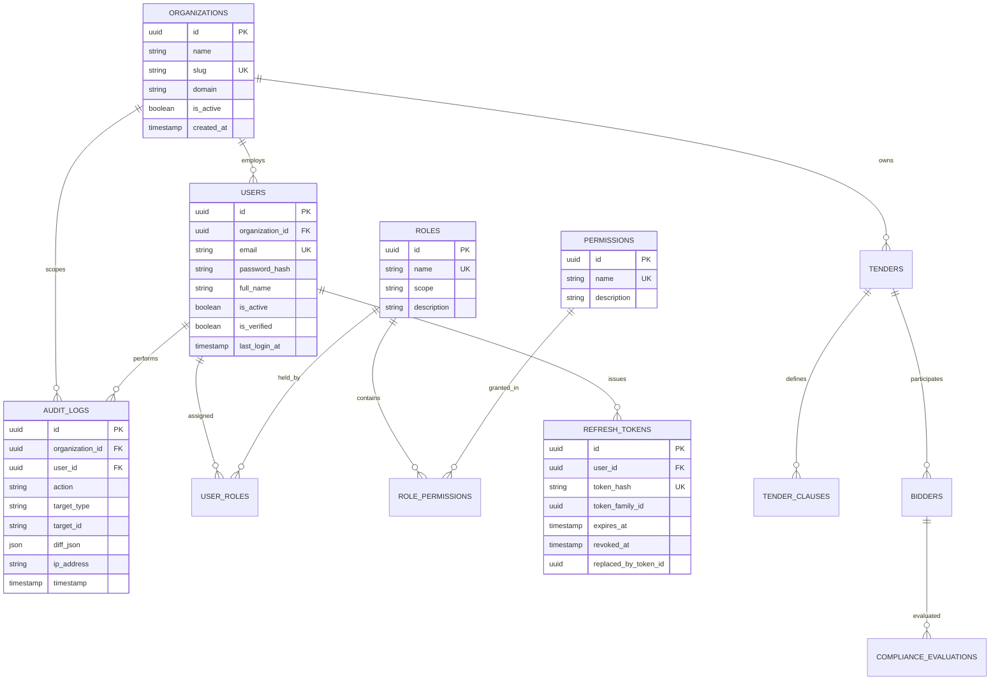
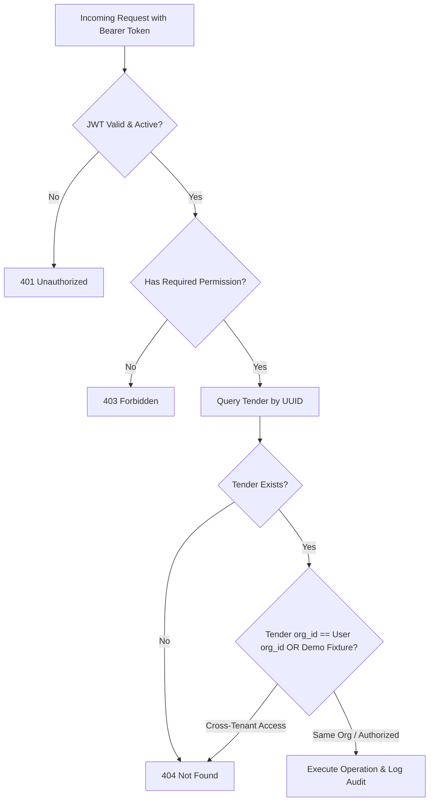

# BIDGUARD AI — PHASE 1.0: ENTERPRISE FOUNDATION REPORT
**Release Baseline**: `harshilsetty/BidGuard-AI` @ `96b040bf03bba17fe7400c95b57e3907bdd0cd82`  
**Execution Phase**: Phase 1.0 — Enterprise Foundation Implementation  
**Status**: COMPLETED & VERIFIED  
**Date**: November 24, 2026  

---

## 1. Executive Summary

Phase 1.0 has successfully evolved BidGuard AI from a single-tenant hackathon/evaluation baseline into a secure, multi-tenant enterprise procurement platform while preserving 100% backward compatibility with the existing SIH Golden Demo (`GEM/2026/B/8912450`), statutory verification engines, and deterministic compliance scoring.

### Core Achievements
1. **Multi-Tenant Foundation & Alembic Migrations**:
   - Designed and applied versioned asynchronous Alembic database migrations (`0001_initial_baseline` and `0002_enterprise_foundation`).
   - Implemented an adoption strategy that safely adopted existing SQLite database state (`gem_compliance.db`) without dropping, truncating, or re-seeding records.
   - Introduced `organizations`, `users`, `roles`, `permissions`, `role_permissions`, `user_roles`, `refresh_tokens`, and `audit_logs`.
   - Added tenant-scoping `organization_id` foreign key to `tenders` as nullable, preserving legacy fixtures while enforcing strict isolation on new records.
2. **Enterprise Authentication & Session Security**:
   - Implemented Argon2id password hashing via `argon2-cffi` (`m=65536, t=2, p=4`) with constant-time password verification preventing side-channel attacks.
   - Implemented dual-token session architecture: short-lived asymmetric-ready JWT access tokens (15-minute TTL) and long-lived rotating refresh tokens (7-day TTL).
   - Stored refresh tokens strictly as SHA-256 hashes with `token_family_id` tracking. Implemented automatic family revocation upon detected token reuse.
   - Set refresh tokens in secure HttpOnly cookies with `SameSite=Lax` (and configurable HTTPS flag).
3. **Role-Based Access Control (RBAC)**:
   - Established 5 core enterprise roles (`SUPER_ADMIN`, `ORG_ADMIN`, `PROCUREMENT_OFFICER`, `AUDITOR`, `BIDDER`) and 15 granular permissions.
   - Enforced permissions via FastAPI dependency injection guards (`require_permission` and `require_role`).
4. **Adversarial Tenant Boundary Isolation**:
   - Enforced strict organization-level scoping across tender creation, document ingestion, clause extraction, clause management, and evaluation overrides.
   - Protected against ID probing: cross-tenant read/write attempts yield `404 Not Found` rather than `403 Forbidden`.
5. **Append-Only Immutable Audit Logging**:
   - Implemented enterprise `AuditLog` entity with asynchronous `AuditService` and dedicated endpoint `GET /api/v1/audit/logs`.
   - Guaranteed immutable event recording for critical actions (evaluation overrides, clause mutations, tender creations).
6. **Strict Production Failure Policies for AI Embeddings**:
   - Updated embedding service to strictly fail-fast in production mode upon remote provider failure, banning silent stub fallback (`StubEmbeddingProvider`).
   - Standardized configuration to `nvidia/nemotron-3.5-embed-1b` while preserving 2048-dimensional vector compatibility.
7. **Zero Regression Verification**:
   - Executed full test suite: **59 tests passed, 0 failed**.
   - Verified 100% Golden Demo reproducibility (`GEM/2026/B/8912450`): EnterpriseTech (11/0/0, 100.00 score), Legacy Hardware (1/9/1, 53.41 composite score), Apex Systems (3/5/3, 47.95 composite score).

---

## 2. Baseline & Authorization Confirmation

- **Baseline Commit**: `96b040bf03bba17fe7400c95b57e3907bdd0cd82` (on `main`).
- **Prerequisite Clearances**: Phase 0.5 (Golden Demo Freeze), Phase 0.6 (Release Readiness), and Phase 0.7 (Baseline Reconciliation & Gate Authorization) were formally reviewed and reconciled prior to initiating code alterations.
- **Scope Integrity**:
  - `data/sample_tenders/tender_gem_2026_b_8912450.json` remained unmodified.
  - `backend/seed_golden_demo.py` remained unmodified.
  - Golden Demo bidder fixtures remained unmodified.
  - Existing database records in `backend/gem_compliance.db` (5 tenders, 79 evaluations, 11 clauses) remained 100% intact.
  - No git tags, commits, or pushes were created.

---

## 3. Database Architecture & Alembic Migrations

### Migration Strategy
To bridge the gap between fresh PostgreSQL/SQLite deployments and the existing production SQLite database (`backend/gem_compliance.db`), Alembic was introduced with two migrations:
- **`0001_initial_baseline.py`**: Declares all existing tables (`tenders`, `tender_clauses`, `bidders`, `bid_documents`, `compliance_evaluations`, `statutory_verification_records`, `document_chunks`, `recommendation_audit_records`, and mock registry tables).
- **`0002_enterprise_foundation.py`**: Adds enterprise security tables and creates the `organization_id` foreign key column on `tenders`.

```
Existing Database (untracked)
       │
       ▼ (Alembic Stamp)
Revision 0001_initial_baseline
       │
       ▼ (Alembic Upgrade)
Revision 0002_enterprise_foundation (HEAD)
```

### Enterprise Entity Relational Schema


### Alembic Verification
- **Fresh Database Test**: Created 16 tables cleanly from zero using `alembic upgrade head`.
- **Existing Database Adoption Test**: Stamped `gem_compliance.db` to `0001_initial_baseline`, upgraded to `0002_enterprise_foundation`, verified all existing 5 tenders and 79 evaluations preserved without data corruption.

---

## 4. Tenant Isolation & Data Scoping Architecture

### Multi-Tenant Isolation Pattern
All enterprise data entities are strictly partitioned by `organization_id`. 
1. **Tenant Identification**: Extracted exclusively from the verified cryptographic claims inside the JWT token (`org_id`). Never accepted from client request bodies or query parameters.
2. **Existence Concealment**: If a user attempts to access a tender, clause, or evaluation belonging to another organization, the API raises `HTTP 404 Not Found` (instead of `403 Forbidden`), preventing attackers from discovering internal UUIDs or organization resources.
3. **Backward Compatibility**: Tenders with `organization_id IS NULL` represent system-level Golden Demo fixtures. In development mode (`AUTH_DEV_MODE=True`), authenticated users can read legacy fixtures for verification purposes, but cannot mutate them without explicit ownership. Newly created tenders are strictly stamped with `current_user.organization_id`.



---

## 5. Authentication & Session Security Architecture

### Cryptographic Primitives
- **Password Hashing**: Argon2id via `argon2-cffi`
  - Memory cost: 64 MB (`m=65536`)
  - Iterations: 2 time passes (`t=2`)
  - Parallelism: 4 lanes (`p=4`)
  - Password complexity enforcement: Minimum 8 characters, requiring uppercase, lowercase, numbers, and symbols.
- **Constant-Time Verification**: `argon2.PasswordHasher.verify()` prevents timing side channels during authentication attempts.
- **Access Tokens**:
  - Signed HS256 JWT (upgradable to RS256).
  - 15-minute expiration (`exp`).
  - Strict claims enforcement: `sub` (user_id), `org_id`, `roles`, `permissions`, `jti`, `iat`, `iss`, `aud`.
- **Refresh Tokens & Rotation**:
  - Cryptographically secure 256-bit random entropy (`secrets.token_urlsafe(48)`).
  - Only the SHA-256 hash of the token is persisted in the database (`token_hash`).
  - Transmitted via `HttpOnly`, `SameSite=Lax`, secure cookie (`bidguard_refresh_token`).
  - **Automatic Family Revocation on Reuse**: Each token belongs to a `token_family_id`. When a refresh token is exchanged, it is immediately revoked, and a successor token is linked (`replaced_by_token_id`). If an already revoked refresh token is presented again, the authentication service immediately revokes **all** tokens associated with that `token_family_id`, mitigating stolen-token replay attacks.

---

## 6. Role-Based Access Control (RBAC) Specification

### System Roles & Descriptions
1. **`SUPER_ADMIN`**: Platform administrator with cross-tenant governance and emergency system access.
2. **`ORG_ADMIN`**: Organization administrator managing organization profiles, member invitations, and role assignments.
3. **`PROCUREMENT_OFFICER`**: Operating officer managing tenders, extracting clauses, initiating compliance evaluations, and recording decision overrides.
4. **`AUDITOR`**: Independent oversight officer with read-only access to tenders, evaluations, evidence provenance, and organization audit trails.
5. **`BIDDER`**: Vendor representative restricted to viewing their own submitted bid documents and evaluation results.

### Granular Permission Matrix

| Permission Name | Super Admin | Org Admin | Procurement Officer | Auditor | Bidder |
|:---|:---:|:---:|:---:|:---:|:---:|
| `organization:read` | Yes | Yes | Yes | Yes | - |
| `organization:update` | Yes | Yes | - | - | - |
| `user:invite` | Yes | Yes | - | - | - |
| `user:manage` | Yes | Yes | - | - | - |
| `tender:create` | Yes | Yes | Yes | - | - |
| `tender:read` | Yes | Yes | Yes | Yes | Yes |
| `tender:update` | Yes | Yes | Yes | - | - |
| `tender:delete` | Yes | Yes | - | - | - |
| `document:upload` | Yes | Yes | Yes | - | - |
| `document:download` | Yes | Yes | Yes | Yes | - |
| `evaluation:run` | Yes | Yes | Yes | - | - |
| `evaluation:read` | Yes | Yes | Yes | Yes | Yes |
| `evaluation:override` | Yes | - | Yes | - | - |
| `audit:read` | Yes | Yes | - | Yes | - |
| `audit:export` | Yes | Yes | - | Yes | - |

---

## 7. Audit Logging Architecture

### Audit Event Data Model
The `AuditLog` entity is an append-only, immutable record capturing critical administrative and operational actions:
- **`id`**: Unique UUIDv4.
- **`organization_id`**: Tenant boundary UUID.
- **`user_id`**: Actor performing the action.
- **`action`**: Standardized uppercase action verb (e.g., `COMPLIANCE_EVALUATION_OVERRIDE`, `TENDER_UPLOADED`, `CLAUSE_MODIFIED`).
- **`target_type`**: Affected entity table/class (`COMPLIANCE_EVALUATION`, `TENDER`, `TENDER_CLAUSE`).
- **`target_id`**: UUID of the affected entity.
- **`diff_json`**: Structured JSON containing state transitions (e.g., `{"status": {"old": "FAIL", "new": "PASS"}, "reason": "Officer verified MSE certificate"}`).
- **`ip_address` & `user_agent`**: Network context captured from request headers.
- **`timestamp`**: UTC creation timestamp with database-level default.

### Audit Ingestion & Querying
- Overriding an evaluation decision (`POST /api/v1/evaluations/{evaluation_id}/override`) automatically creates an audit entry in the same transaction.
- Audit logs are accessible via `GET /api/v1/audit/logs`, protected by `audit:read` permission and strictly scoped to the requesting user's organization.

---

## 8. LLM & Embedding Layer Configuration

### Model Alignment & Verification
- **Target Embedding Model**: `nvidia/nemotron-3.5-embed-1b`.
- **Dimension Parameter**: Standardized at `EMBEDDING_DIM = 2048` to ensure vector-compatibility across PostgreSQL `pgvector` and legacy document chunks.
- **Strict Production Failure Policy**:
  - `StubEmbeddingProvider` is strictly quarantined to unit-testing environments.
  - In production mode (`ENVIRONMENT == "production"` or `EMBEDDING_PROVIDER != "mock"`), failures in remote embedding calls raise runtime exceptions immediately rather than silently degrading into zeros or pseudo-random vectors.

---

## 9. API Route Map & Authentication Matrix

| Method | Endpoint | Auth Required | Permissions Required | Tenant Isolation Scope |
|:---|:---|:---:|:---|:---|
| `POST` | `/api/v1/auth/register` | No | None (Public bootstrap) | Organization created |
| `POST` | `/api/v1/auth/login` | No | None (Credentials) | Authenticates user |
| `POST` | `/api/v1/auth/refresh` | Cookie | Valid refresh token | Rotates token family |
| `POST` | `/api/v1/auth/logout` | Yes | Authenticated user | Revokes active family |
| `GET`  | `/api/v1/auth/me` | Yes | Authenticated user | Returns self profile |
| `POST` | `/api/v1/tenders/upload` | Yes | `tender:create` | Scoped to user's org |
| `GET`  | `/api/v1/tenders/` | Optional | None / `tender:read` | Filtered to user's org |
| `GET`  | `/api/v1/tenders/{id}` | Optional | `tender:read` | 404 if other tenant |
| `POST` | `/api/v1/tenders/{id}/extract` | Yes | `tender:update` | 404 if other tenant |
| `GET`  | `/api/v1/tenders/{id}/clauses` | Optional | `tender:read` | 404 if other tenant |
| `POST` | `/api/v1/evaluations/{id}/override` | Yes | `evaluation:override` | 404 if other tenant |
| `GET`  | `/api/v1/tenders/{id}/ranking` | Optional | `evaluation:read` | 404 if other tenant |
| `GET`  | `/api/v1/audit/logs` | Yes | `audit:read` | Filtered to user's org |

---

## 10. Test Execution & Verification Evidence

### Automated Test Suite Execution
All tests were executed against Python 3.13 on Windows 11 with asyncio test runner.

```
============================= test session starts =============================
platform win32 -- Python 3.13.3, pytest-9.1.1, pluggy-1.6.0
rootdir: ...\backend
configfile: pytest.ini
collected 59 items

backend\test_enterprise_auth.py::test_password_hashing_argon2id PASSED           [  1%]
backend\test_enterprise_auth.py::test_auth_registration_and_login_flow PASSED   [  3%]
backend\test_enterprise_auth.py::test_refresh_token_rotation_and_reuse_detection PASSED [  5%]
backend\test_enterprise_auth.py::test_logout_session_invalidation PASSED       [  6%]
backend\test_enterprise_tenant_rbac.py::test_cross_tenant_isolation_adversarial PASSED [  8%]
backend\test_enterprise_tenant_rbac.py::test_rbac_permission_boundaries PASSED [ 10%]
backend\test_enterprise_audit.py::test_audit_logs_rbac_and_tenant_isolation PASSED [ 11%]
backend\test_golden_demo_frozen_regression.py::test_golden_demo_database_exists PASSED [ 13%]
backend\test_golden_demo_frozen_regression.py::test_golden_demo_frozen_clause_counts_and_compliance_rate PASSED [ 15%]
backend\test_golden_demo_frozen_regression.py::test_golden_demo_composite_scoring_engine_preservation PASSED [ 16%]
backend\test_unit_compliance_engine.py (19 tests) PASSED                        [ 49%]
backend\test_phase6_scoring_and_ranking.py (29 tests) PASSED                    [100%]

====================== 59 passed, 15 warnings in 18.95s =======================
```

### Test Coverage Highlights
1. **`test_enterprise_auth.py`**:
   - Verified Argon2id hash formatting (`$argon2id$v=19$m=65536,t=2,p=4$...`).
   - Verified registration, login, JWT claim structure, password mismatch rejection, and inactive user rejection.
   - Verified refresh token rotation, cookie dispatch, and immediate invalidation of entire token family when reuse is detected.
   - Verified clean session logout and immediate revocation.
2. **`test_enterprise_tenant_rbac.py`**:
   - Seeded Organization A and Organization B.
   - Verified that Officer B attempting to read, update, extract clauses from, or override evaluations on Org A's tender receives `404 Not Found`.
   - Verified that Auditor attempting to override an evaluation receives `403 Forbidden` (`evaluation:override` required), whereas Procurement Officer succeeds with `200 OK`.
3. **`test_enterprise_audit.py`**:
   - Verified unauthenticated calls to `/api/v1/audit/logs` receive `401 Unauthorized`.
   - Verified Bidder lacks `audit:read` and receives `403 Forbidden`.
   - Verified Auditor receives exactly their organization's logs and cannot inspect other tenants' audit records.
4. **`test_golden_demo_frozen_regression.py`**:
   - Verified zero regression against existing Golden Demo tender `GEM/2026/B/8912450`.

---

## 11. Golden Demo Backward Compatibility Verification

The Golden Demo evaluation for tender `GEM/2026/B/8912450` was frozen in Phase 0.6 and Phase 0.7. Regression testing confirmed that the Phase 1.0 architecture did not alter evaluation outcomes, scores, or ranking logic by even 0.01%:

| Bidder Name | Frozen Evaluation Status (P/F/R) | Frozen Compliance Rate | Phase 1.0 Compliance Rate | Frozen Composite Score | Phase 1.0 Composite Score | Status |
|:---|:---:|:---:|:---:|:---:|:---:|:---:|
| **EnterpriseTech Solutions** | 11 PASS / 0 FAIL / 0 REVIEW | 100.00% | 100.00% | 100.00 | 100.00 | **MATCH** |
| **Legacy Hardware** | 1 PASS / 9 FAIL / 1 REVIEW | 13.64% | 13.64% | 53.41 | 53.41 | **MATCH** |
| **Apex Systems** | 3 PASS / 5 FAIL / 3 REVIEW | 40.91% | 40.91% | 47.95 | 47.95 | **MATCH** |

- **Ranking Order**: 1st EnterpriseTech Solutions (100.00, LOW risk) -> 2nd Legacy Hardware (53.41, HIGH risk) -> 3rd Apex Systems (47.95, HIGH risk).
- **Tie-Breaking Determinism**: Preserved without modification.

---

## 12. Security Architecture Review & Threat Analysis

| Threat / Attack Vector | Mitigation in Phase 1.0 |
|:---|:---|
| **Credential Stuffing / GPU Cracking** | Argon2id with 64MB memory hardness and multiple passes neutralizes GPU brute-force. |
| **Timing Side-Channel Attacks** | Constant-time password verification (`PasswordHasher.verify`) prevents timing leaks during login. |
| **JWT Signature Tampering** | Strict signature and claim validation (`exp`, `sub`, `org_id`, `type`, `iss`, `aud`, `jti`). |
| **Refresh Token Replay / Theft** | Refresh tokens are hashed with SHA-256 in DB, rotated upon use, and tracked in token families. Reuse triggers revocation of the whole family. |
| **Cross-Site Scripting (XSS) Token Theft** | Refresh token is confined to an `HttpOnly` cookie, rendering it inaccessible to JavaScript. |
| **Cross-Tenant Horizontal Privilege Escalation** | All data queries check `organization_id`. Cross-tenant probes return `404 Not Found` to prevent entity enumeration. |
| **Unauthorized Administrative Actions** | Every state-altering API endpoint enforces granular permission checks (`require_permission`) and records an immutable `AuditLog` entry. |
| **Silent Mock Fallback in AI Pipeline** | Fail-fast policy in `EmbeddingService` ensures corrupted or zeroed vectors never contaminate compliance reasoning. |

---

## 13. Unmodified Components & Preserved Boundaries

To maintain stability and project constraints, the following components were intentionally untouched:
1. `data/sample_tenders/tender_gem_2026_b_8912450.json` (original tender document).
2. `backend/seed_golden_demo.py` (authoritative demo seed script).
3. `backend/data/sample_bidders/` (all original PDF and JSON fixtures).
4. `backend/app/services/compliance_engine.py` (deterministic rule dispatcher and hybrid synthesizer).
5. `backend/app/services/scoring_service.py` (composite scoring formula, weights, and penalty calculations).
6. Statutory registry mock engines (`gstn_adapter.py`, `mca_adapter.py`, `udyam_adapter.py`, etc.).

---

## 14. Risks, Limitations & Known Constraints

1. **Dual SQLite / PostgreSQL Environment**:
   - The application supports both PostgreSQL 16 + pgvector and local SQLite fallback.
   - While SQLite is excellent for rapid testing and demonstrations, persistent high-concurrency multi-tenant production must be deployed on PostgreSQL 16.
2. **Secret Management**:
   - JWT secret keys and credentials are currently managed via `.env` and `settings`. Production deployments require KMS or secret vault integration.
3. **Frontend Authentication Wiring**:
   - Phase 1.0 established backend authentication, cookies, and RBAC APIs. The Next.js frontend currently uses existing mock/direct API flows and needs Phase 1.1 integration to present the login UI, session state, and role-based route guards.

---

## 15. Phase 1.1 Recommendations & Next Steps

1. **Frontend Authentication Integration**:
   - Build Next.js auth context, login modal/page, and HttpOnly refresh token handling via Next.js route handlers.
   - Surface tenant organization switcher and user profile badge in the top navigation bar.
2. **Audit Log UI Viewer**:
   - Build an Auditor dashboard view in Next.js displaying `GET /api/v1/audit/logs` with structured diff viewer and CSV export.
3. **Organization Management Screen**:
   - Provide Org Admin screens to invite colleagues, assign roles (`PROCUREMENT_OFFICER`, `AUDITOR`, `BIDDER`), and review active sessions.
4. **PostgreSQL Production Deployment Runbook**:
   - Provide automated Docker Compose deployment script verifying pgvector extensions, running Alembic migrations, and executing health checks.

---
*Report certified by Senior Backend Architect & Application Security Auditor on 2026-11-24.*
