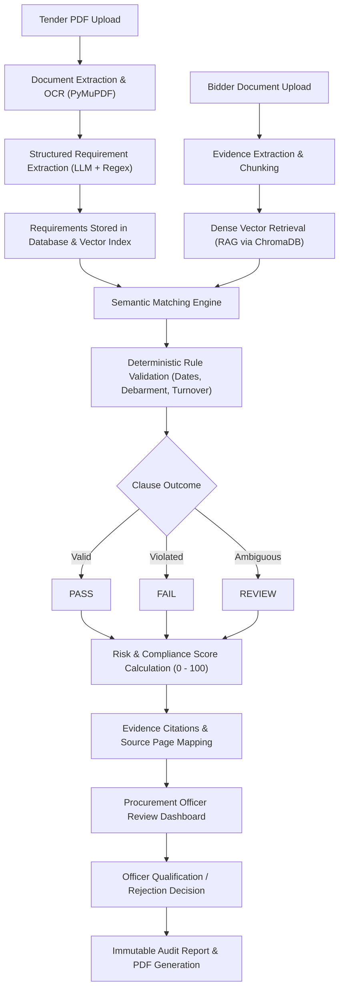

# Data Flow & Lifecycle — BidGuard (SIH26100)

This document maps the complete end-to-end data lifecycle of a bid verification workflow in BidGuard.

---

## 1. End-to-End Flow Diagram

---

## 2. Step-by-Step Execution Sequence

### Step 1: Tender Document Upload
- **Trigger**: Procurement officer uploads the tender specification or Notice Inviting Tender (NIT) via the dashboard.
- **Processing**: Uploaded PDF is assigned a unique UUID and stored in `uploads/tenders/`.

### Step 2: Extraction & OCR Fallback
- **Component**: `ai-engine/extractors/pdf_extractor.py` (PyMuPDF).
- **Behavior**: Inspects page character density. If text is embedded, it extracts native vector text. If scanned image, OCR fallback (Tesseract) is triggered.

### Step 3: Requirement Extraction & Normalization
- **Component**: `ai-engine/extractors/requirement_extractor.py`.
- **Behavior**: Chunks text and maps eligibility clauses to standardized types (`Financial`, `Technical`, `Statutory`, `Experience`, `Debarment`).

### Step 4: Bidder Submission Ingestion
- **Trigger**: Bidder technical dossiers and statutory certificates are uploaded.
- **Storage**: Stored in `uploads/bidders/` and chunked with bounding page metadata.

### Step 5: Evidence Extraction & RAG Retrieval
- **Component**: `ai-engine/rag/retriever.py` & ChromaDB.
- **Behavior**: Chunks are embedded and queried against the requirement clause embeddings to retrieve top-k matching candidate paragraphs.

### Step 6: Semantic Matching & Deterministic Validation
- **Component**: `ai-engine/matcher/`.
- **Hybrid Rule**:
  - Semantic matcher analyzes textual alignment.
  - Deterministic validator runs hard business logic:
    - **Turnover**: Compares numeric values in audited financial certificates.
    - **Debarment**: Checks central/state blacklist registers for active ban periods.
    - **Validity Dates**: Checks registration and certificate expiration dates.

### Step 7: Clause Status Assignment
- Each clause is marked strictly as:
  - **`PASS`**: Requirement fully substantiated with valid, verified evidence.
  - **`FAIL`**: Non-compliance detected (e.g. active debarment, turnover below threshold).
  - **`REVIEW`**: Missing evidence, borderline semantic match, or contradictory statutory records.

### Step 8: Risk Scoring & Evidence Citation
- **Component**: `backend/app/services/compliance_engine.py` & `scoring_service.py`.
- **Output**: 100-point composite compliance score + exact page references (`file.pdf`, page 4).

### Step 9: Officer Dashboard & Final Decision Support
- **Interface**: `frontend/src/app/tenders/[id]/compliance/page.tsx`.
- **Workflow**: Officer reviews the compliance matrix, clicks into contested clauses, inspects source document highlights, and inputs official procurement remarks.

### Step 10: Immutable Audit Report
- System generates a cryptographically sealed compliance summary report PDF suitable for official procurement audit.
