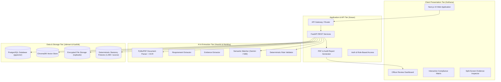

# System Architecture — BidGuard (SIH26100)

**Problem Statement ID**: SIH26100  
**Problem Statement**: AI-Powered Integrated Bid Compliance Verification Platform for GeM Procurement  
**Paradigm**: Human-in-the-Loop Procurement Decision-Support System  

---

## 1. Architectural Philosophy: Hybrid Decision Support

Public procurement on Government e-Marketplace (GeM) and under General Financial Rules (GFR 2017) demands **100% auditable, deterministic compliance**. 

LLMs excel at unstructured text parsing and semantic retrieval, but must never make unchecked, black-box procurement disqualifications. BidGuard implements a **Hybrid Architecture**:

1. **AI / RAG Tier**: Unstructured document parsing (PyMuPDF + OCR), requirement extraction, semantic similarity indexing, and grounding.
2. **Deterministic Rules Tier**: Objective qualification criteria (turnover amounts, dates, active debarment periods, exemption rules) are evaluated by code-level deterministic business rules that override model inference.
3. **Decision-Support Cockpit**: Final qualification or disqualification remains strictly with the human Procurement Officer. The platform provides evidence citations, source page links, and risk scores.

---

## 2. High-Level System Architecture Diagram

---

## 3. Core Component Boundaries

### A. Frontend Tier (`frontend/`)
- **Framework**: Next.js 15 with App Router, React 18, TypeScript, and Tailwind CSS.
- **Key Modules**:
  - **Upload Station**: Chunked multipart file upload for tender specifications and bidder dossiers.
  - **Compliance Matrix**: Dynamic matrix presenting qualification clauses, status chips (`PASS`, `FAIL`, `REVIEW`), confidence bars, and page links.
  - **Evidence Viewer**: Side-by-side document preview with synchronized bounding box / page citations.

### B. Backend API Tier (`backend/`)
- **Framework**: Python 3.12, FastAPI, Pydantic v2, async SQLAlchemy with asyncpg.
- **Responsibilities**:
  - Exposing REST APIs for tender, bidder, verification, and audit telemetry.
  - Generating immutable PDF compliance reports with SHA-256 verification seals.
  - Maintaining temporal debarment timelines and statutory cross-source verification.

### C. AI & Retrieval Tier (`ai-engine/`)
- **Libraries**: PyMuPDF, ChromaDB, Google Generative AI (Gemini) / NVIDIA NIM API.
- **Responsibilities**:
  - Parsing multi-page scanned/unscanned PDFs with OCR fallback.
  - Segmenting qualification requirements into category-specific schemas.
  - Dense vector similarity retrieval to match bidder evidence against clauses.
  - Enforcing the structured AI Output Contract (`PASS`, `FAIL`, `REVIEW`).

### D. Data & Storage Tier (`data/` & PostgreSQL)
- **Database**: PostgreSQL 16 with `pgvector` extension.
- **Vector Store**: ChromaDB for rapid embedding nearest-neighbor searches.
- **Synthetic Statutory Storage**: 1,000 deterministic records per statutory registry (GSTN, Udyam, DPIIT, EPFO, ESIC, NSIC, DigiLocker) with temporal validity and debarment flags.
